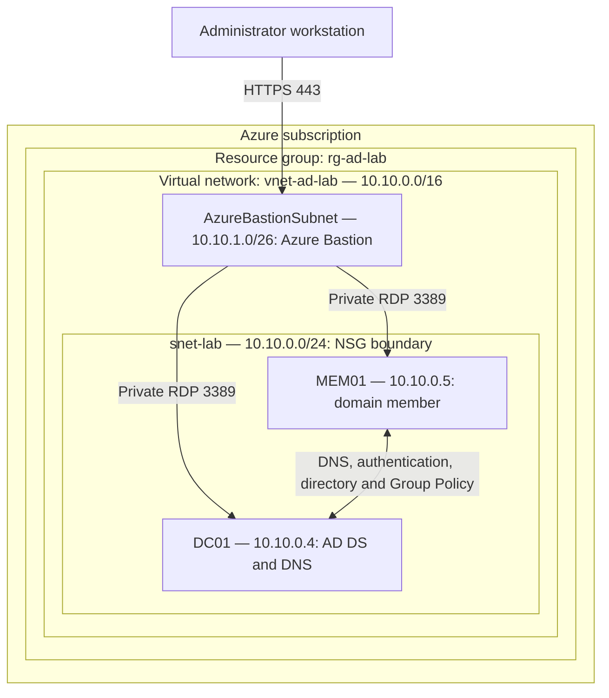
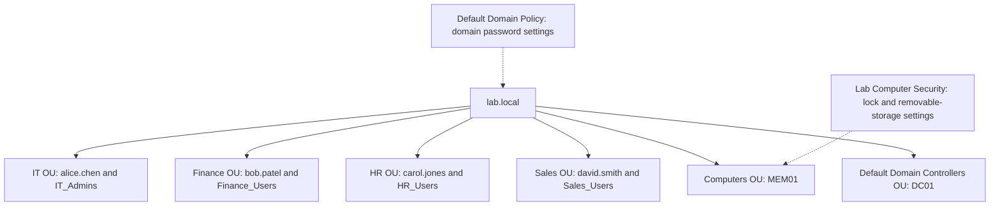

Active Directory Lab on Azure
Windows Server 2025 · Active Directory Domain Services · DNS · Group Policy · Identity Administration

Build an isolated Windows domain, organize departmental identities, join a member server, and validate centrally managed security policies. This lab connects common help desk tasks with the identity and network controls that support cloud security.
This README is a reproducible lab guide based on the supplied lab notes. Verification results and screenshots must be collected from your own deployment; the examples below are expected outcomes, not recorded execution results.

Lab overview
Item	Configuration
Estimated time	3–5 hours, depending on deployment and troubleshooting
Primary platform	Microsoft Azure
Operating system	Windows Server 2025 with Desktop Experience
Domain / NetBIOS name	lab.local / LAB
Domain controller	DC01 — AD DS and DNS
Domain member	MEM01 — policy and domain-join testing
Skills practiced	Directory administration, DNS, Group Policy, account lifecycle, validation
Cost	Depends on subscription, region, VM sizes, disks, and management access

Azure trial credits may offset costs, but this configuration is not guaranteed to be free. Check your offer and the Azure pricing calculator before deployment. An Azure Marketplace Windows Server image is not the same licensing arrangement as the downloadable evaluation ISO.
Business scenario
A small organization needs a central directory for IT, Finance, HR, and Sales. Administrators must provision accounts consistently, organize computers, apply security settings, and disable identities when employees leave.

This lab uses AD DS security groups to represent departmental roles. Creating a group alone does not grant access: permissions must be assigned to that group on a resource. Resource permissions, Microsoft Entra ID synchronization, and Conditional Access are outside this lab's scope.
Architecture
The primary design keeps both VMs on private addresses and uses Azure Bastion for administration. Confirm Bastion availability, tier requirements, and cost before deployment.

Traffic flow: Bastion provides the administrative connection. MEM01 uses DC01 for domain DNS resolution and contacts it for authentication and Group Policy. AD DS requires several protocols, including DNS, Kerberos, LDAP, SMB, and RPC; allowing only DNS and RDP between the VMs is insufficient.

For this isolated lab, retain the NSG's default virtual-network allowance between lab VMs and the Windows Firewall rules installed with the server roles. If tightening rules, use Microsoft's AD firewall guidance. Do not expose AD service ports to the internet.
Directory and policy scope

Keep DC01 in the built-in Domain Controllers OU. Computer policy is linked to the OU containing MEM01, rather than an OU that contains only users.
Prerequisites
- An Azure subscription with permission to create networking, VMs, and the selected management-access resources.
- An available Windows Server 2025 image with a graphical desktop.
- Two VMs with approximately 2 vCPUs and at least 4 GiB RAM each. Standard_B2s is an example, subject to region availability and quota.
- Unique administrator credentials stored in a password manager.
- Elevated Windows PowerShell sessions inside the VMs. Run each command block on the machine identified above it.
- A dedicated lab resource group and a budget alert. Budget alerts notify you; they do not automatically stop spending.
The guide preserves lab.local from the original notes for an isolated exercise. For production, plan a namespace based on a domain you own. A single DC is a lab simplification, not a resilient production design.
1. Deploy the Azure environment
Use the Azure portal to create these resources:
Resource	Name / value
Resource group	rg-ad-lab
Region	One supported region for all lab resources
Virtual network	vnet-ad-lab, address space 10.10.0.0/16
Lab subnet	snet-lab, address range 10.10.0.0/24
Bastion subnet	AzureBastionSubnet, address range 10.10.1.0/26
Domain controller VM	DC01, Windows Server 2025, no VM public IP
Member server VM	MEM01, Windows Server 2025, no VM public IP
OS disks	Standard SSD, with capacity permitted by your image and subscription policy

1. Create the resource group, virtual network, and subnets.
2. Deploy both VMs into snet-lab. Select None for public inbound ports and do not attach VM public IPs.
3. On each VM's network interface, open IP configurations, select the primary configuration, and set private allocation to Static: DC01 10.10.0.4, MEM01 10.10.0.5. Confirm these addresses are available first.
4. Keep IP allocation inside Windows on DHCP; reserve the address through the Azure NIC configuration.
5. Deploy Azure Bastion using its portal deployment wizard and the dedicated subnet. If using custom NSGs, follow the Bastion NSG requirements.
6. Connect to each VM through Connect → Bastion with its local administrator credentials.
7. Install updates and restart as needed before configuring AD DS.
Alternative access: If using temporary public RDP for an isolated exercise, restrict TCP 3389 to your current public IPv4 address with a /32 source rule, remove any broad RDP allow rule, and remove the public IP and rule afterward. This is a different topology from the diagram above. Never allow unrestricted internet RDP to a domain controller.

For a native RDP client, clipboard redirection is under Show Options → Local Resources → Clipboard. Availability also depends on host policy and the chosen connection method.
2. Install AD DS and management tools
Run on DC01 as administrator. Confirm the computer name is DC01 with hostname. If necessary, rename it and restart before proceeding:
Rename-Computer -NewName 'DC01' -Restart
After reconnecting:
Install-WindowsFeature -Name AD-Domain-Services, GPMC -IncludeManagementTools
Get-WindowsFeature -Name AD-Domain-Services, GPMC
Expected result: both features show as installed. AD DS supplies the directory service; GPMC supplies the Group Policy Management Console.
3. Create the forest and domain
A forest is the top-level AD DS structure. This lab creates one forest containing one domain. Promotion makes DC01 a domain controller and installs DNS.

Run on DC01 as administrator:
Import-Module ADDSDeployment
$dsrmPassword = Read-Host 'Enter a unique DSRM recovery password' -AsSecureString
$forestSettings = @{
    DomainName                    = 'lab.local'
    DomainNetbiosName              = 'LAB'
    InstallDns                    = $true
    SafeModeAdministratorPassword = $dsrmPassword
}
Install-ADDSForest @forestSettings
Review the prerequisite checks and confirm installation. The server restarts. Store the Directory Services Restore Mode (DSRM) password securely; do not put it in GitHub.

Reconnect as LAB\<original-admin-username> using the administrator account created with the VM. Do not assume that the Azure VM administrator username is Administrator.

A DNS delegation warning can be expected for this isolated new forest without a parent DNS zone. Review other errors individually.
Configure domain DNS
1. In Azure, open vnet-ad-lab → DNS servers.
2. Select Custom, add 10.10.0.4, and save.
3. Restart MEM01 so it receives the new DNS configuration. For any NIC with a DNS override, remove the override or explicitly configure DC01 as its DNS server.
4. On DC01, check ipconfig /all and ensure its DNS client uses its own DNS service, rather than an unrelated public DNS server.
Verify on DC01:
Get-ADDomain
Get-ADDomainController -Identity 'DC01'
Resolve-DnsName -Name '_ldap._tcp.dc._msdcs.lab.local' -Type SRV -Server 10.10.0.4
Expected result: domain lab.local, controller DC01, and an SRV record pointing to the controller. Do not add public DNS as a secondary resolver on a domain member; configure external resolution through the DC's DNS service if needed.
4. Create departmental OUs, groups, and users
An organizational unit (OU) organizes directory objects and provides a policy/delegation boundary. A security group collects identities that can be granted permissions together.

Run on DC01 in elevated PowerShell. These creation commands are intended for a fresh lab; rerunning them can report that objects already exist.
Import-Module ActiveDirectory
$baseDN = 'DC=lab,DC=local'
foreach ($ou in 'IT', 'Finance', 'HR', 'Sales', 'Computers') {
    New-ADOrganizationalUnit -Name $ou -Path $baseDN -ProtectedFromAccidentalDeletion $true
}

$people = @(
    @{ First='Alice'; Last='Chen';  Login='alice.chen';  OU='IT';      Group='IT_Admins' },
    @{ First='Bob';   Last='Patel'; Login='bob.patel';   OU='Finance'; Group='Finance_Users' },
    @{ First='Carol'; Last='Jones'; Login='carol.jones'; OU='HR';      Group='HR_Users' },
    @{ First='David'; Last='Smith'; Login='david.smith'; OU='Sales';   Group='Sales_Users' }
)

foreach ($person in $people) {
    $ouPath = "OU=$($person.OU),$baseDN"
    New-ADGroup -Name $person.Group -GroupScope Global -GroupCategory Security -Path $ouPath
    $initialPassword = Read-Host "Unique temporary password for $($person.Login) (12+ characters)" -AsSecureString
    $userSettings = @{
        Name                  = $person.Login
        GivenName             = $person.First
        Surname               = $person.Last
        SamAccountName        = $person.Login
        UserPrincipalName     = "$($person.Login)@lab.local"
        Path                  = $ouPath
        AccountPassword       = $initialPassword
        Enabled               = $true
        ChangePasswordAtLogon = $true
    }
    New-ADUser @userSettings
    Add-ADGroupMember -Identity $person.Group -Members $person.Login
}
IT_Admins is only a custom group name. It does not confer administrative rights, and this lab does not add it to Domain Admins.

Open Server Manager → Tools → Active Directory Users and Computers, or run dsa.msc, to inspect the objects. The new Computers OU is separate from the built-in CN=Computers container.
5. Configure password and computer policies
Domain account policy
Open gpmc.msc. Expand Forest: lab.local → Domains → lab.local. Edit Default Domain Policy and navigate to:

Computer Configuration → Policies → Windows Settings → Security Settings → Account Policies

Set these exercise values:
Policy section	Setting	Lab value
Password Policy	Minimum password length	12 characters
Password Policy	Password must meet complexity requirements	Enabled
Account Lockout Policy	Account lockout threshold	10 invalid attempts
Account Lockout Policy	Account lockout duration	15 minutes
Account Lockout Policy	Reset account lockout counter after	15 minutes

These are illustrative lab values, not a complete organizational password standard. Windows complexity uses character-category and account-name rules; it does not simply require all four of uppercase, lowercase, numbers, and symbols.

Scope matters: An account-policy GPO linked only to a departmental OU does not set the domain password policy for that OU's users. Use domain-level policy for the domain baseline, or fine-grained password policies for selected users/global security groups. Password changes and creation enforce the new requirements; existing passwords are not automatically rewritten.

On DC01, refresh and inspect:
gpupdate /force
Get-ADDefaultDomainPasswordPolicy | Select-Object MinPasswordLength, ComplexityEnabled, LockoutThreshold, LockoutDuration, LockoutObservationWindow
Computer security policy
In Group Policy Management, right-click the Computers OU, choose Create a GPO in this domain, and Link it here, and name it Lab Computer Security. Edit the GPO:
Path under Computer Configuration → Policies	Setting	Value
Windows Settings → Security Settings → Local Policies → Security Options	Interactive logon: Machine inactivity limit	900 seconds
Administrative Templates → System → Removable Storage Access	All Removable Storage classes: Deny all access	Enabled

Leave default security filtering for this exercise. The removable-storage setting limits supported storage classes; it is not a complete data-loss-prevention solution. An Azure VM might not expose removable storage, so policy application can be verified without claiming a physical USB test.
6. Join MEM01 to the domain
Run on MEM01 as its local administrator. Ensure its hostname is MEM01; rename and restart first if necessary.
ipconfig /all
Resolve-DnsName -Name '_ldap._tcp.dc._msdcs.lab.local' -Type SRV
Test-NetConnection -ComputerName DC01.lab.local -Port 389
Expected result: DNS uses 10.10.0.4, the SRV lookup finds DC01, and the LDAP TCP test succeeds. This port test alone does not validate every AD protocol.
$joinCredential = Get-Credential -UserName 'LAB\YOUR-ADMIN-USERNAME' -Message 'Enter the lab domain administrator credentials'
$joinSettings = @{
    DomainName = 'lab.local'
    OUPath     = 'OU=Computers,DC=lab,DC=local'
    Credential = $joinCredential
    Restart    = $true
}
Add-Computer @joinSettings
Replace YOUR-ADMIN-USERNAME with your real lab administrator username. The VM restarts and its computer object is placed directly in the policy-linked OU. Domain administrator credentials are used for simplicity in this isolated lab; production joins should use appropriately delegated permissions.

Reconnect to MEM01 as the domain administrator, then run:
Get-CimInstance Win32_ComputerSystem | Select-Object Name, Domain, PartOfDomain
Test-ComputerSecureChannel -Verbose
gpupdate /force
New-Item -Path 'C:\LabEvidence' -ItemType Directory -Force | Out-Null
gpresult /scope computer /h 'C:\LabEvidence\MEM01-GroupPolicy.html' /f
Expected result: PartOfDomain is True, the secure-channel test returns True, and the report lists Lab Computer Security. Inspect the report and test the 15-minute inactivity lock.

Ordinary domain users are not automatically permitted to RDP to a member server or DC. Do not grant them DC logon rights for testing. Accounts requiring a password change can also fail an initial NLA-protected RDP login; complete the change through an authorized interactive domain session before testing RDP, instead of disabling NLA.
7. Practice help desk and account lifecycle tasks
Run on DC01 with the appropriate directory permissions. Verify the requester's identity and authorization before performing equivalent tasks in a real environment.
Reset a password
$newPassword = Read-Host 'Enter a unique temporary password for Bob' -AsSecureString
Set-ADAccountPassword -Identity 'bob.patel' -Reset -NewPassword $newPassword
Set-ADUser -Identity 'bob.patel' -ChangePasswordAtLogon $true
Provide the temporary password through an approved secure channel. Never commit it to the repository.
Check and unlock an account
Get-ADUser -Identity 'carol.jones' -Properties LockedOut | Select-Object SamAccountName, LockedOut
Unlock-ADAccount -Identity 'carol.jones'
Get-ADUser -Identity 'carol.jones' -Properties LockedOut | Select-Object SamAccountName, LockedOut
If Carol was not locked out, this demonstrates the command but does not prove recovery from an actual lockout. Investigate repeated lockouts rather than repeatedly unlocking an account without finding the cause.
Disable an account for offboarding
Disable-ADAccount -Identity 'david.smith'
Get-ADUser -Identity 'david.smith' | Select-Object SamAccountName, Enabled
Expected result: Enabled is False. Disabling an AD account does not instantly terminate every existing session or revoke every already-issued ticket, and it does not automatically disable unrelated cloud accounts.

To restore David's test account for another lab run:
Enable-ADAccount -Identity 'david.smith'
Review membership and inactive accounts
Get-ADPrincipalGroupMembership -Identity 'alice.chen' | Select-Object Name
Search-ADAccount -AccountDisabled -UsersOnly | Select-Object Name, SamAccountName

$cutoff = (Get-Date).AddDays(-90)
Get-ADUser -Filter 'Enabled -eq $true' -Properties LastLogonDate, WhenCreated |
    Where-Object { $_.LastLogonDate -and $_.LastLogonDate -lt $cutoff } |
    Select-Object SamAccountName, LastLogonDate

# Review never-used accounts separately; do not automatically label new accounts stale.
Get-ADUser -Filter 'Enabled -eq $true' -Properties LastLogonDate, WhenCreated |
    Where-Object { -not $_.LastLogonDate } |
    Select-Object SamAccountName, WhenCreated
LastLogonDate is based on a replicated timestamp and can lag. Use it for an initial review, not as an exact real-time audit record or an automatic deletion decision.
8. Verification checklist
Capture your actual results before marking these complete.
- [ ] DC01 is returned by Get-ADDomainController -Identity 'DC01'.
- [ ] Domain DNS SRV lookup succeeds from MEM01.
- [ ] ADUC shows the five custom OUs and all four departmental groups.
- [ ] Get-ADGroupMember -Identity 'IT_Admins' returns Alice.
- [ ] Get-ADDefaultDomainPasswordPolicy shows the configured password and lockout values.
- [ ] MEM01 is joined to lab.local and located in the Computers OU.
- [ ] Test-ComputerSecureChannel returns True on MEM01.
- [ ] MEM01's Group Policy report lists Lab Computer Security.
- [ ] The inactivity lock behavior has been tested.
- [ ] Password reset, account unlock checks, and account disablement have been documented.
After the offboarding exercise, David should be disabled unless you deliberately re-enabled him. Do not expect all four users to remain enabled at every stage.
Troubleshooting
Symptom	Checks and resolution
Domain cannot be found	Confirm MEM01 uses DC01 for DNS; test the domain SRV record; check DC01 is running and network/firewall rules permit AD traffic.
VM inaccessible after DNS/network changes	Verify VM status, Bastion/network rules, and credentials. Allow restarts to complete; inspect Azure NIC settings before changing Windows IP allocation.
GPO missing from results	Check MEM01 is in the Computers OU, the link and computer settings are enabled, filtering permits the computer, and DNS works. Run gpupdate /force and inspect the computer-scope report.
Password policy has no effect on domain users	Check the domain-level account policy and any fine-grained policy. A departmental OU link is insufficient for domain user password policy.
New-ADUser prompts for Name	A required parameter was omitted or the pasted command broke across lines. Use the complete splatted block; an undefined password variable is a separate issue.
User object exists but is disabled	A password operation may have failed during creation. Inspect the account, set a compliant password, then enable it deliberately.
Access denied when connecting as a test user	Check permitted logon rights and first-login password-change requirements. Group membership alone does not authorize RDP.
GPMC or ADUC missing	Install GPMC and AD DS management tools; open gpmc.msc or dsa.msc.
Cannot resolve external names	Inspect DNS forwarding/root hints and outbound connectivity. Do not replace the member's domain DNS server with public DNS.
VM size or disk deployment denied	Review the exact Azure Policy or quota error and select compliant resources; do not assume every region or subscription permits the example configuration.

Portfolio evidence
Add sanitized screenshots to a screenshots/ folder and link them here after capture. Suggested evidence:
Suggested filename	What to capture
01-domain-controller.png	DC01 domain/controller verification
02-directory-structure.png	OUs, departmental users, and groups in ADUC
03-domain-policy.png	Effective domain password and lockout settings
04-domain-membership.png	MEM01 domain membership and secure-channel result
05-group-policy.png	Applied computer GPO and configured settings
06-account-lifecycle.png	Account state before and after an administrative task

Remove credentials, subscription identifiers, public IPs, and unrelated personal information before publishing. Keep exported reports private until reviewed. No screenshots or successful execution results are included in this README.
Cleanup and cost control
- For temporary pauses, stop/deallocate the VMs through Azure and confirm Stopped (deallocated). Shutting down Windows alone can leave compute billable.
- Disks, public IPs, Bastion, and other provisioned services may continue to incur costs after VM deallocation.
- When resuming, start DC01 first and confirm DNS/AD DS are healthy before starting MEM01.
- When finished, save sanitized evidence, inspect rg-ad-lab to confirm it contains only disposable lab resources, then delete that resource group through the Azure portal. This permanently removes those resources.
For repeat exercises, re-enable David when needed, unlock test users, and review existing directory objects before rerunning creation commands. To reverse the computer-policy exercise, unlink Lab Computer Security, refresh policy, and verify effective settings; some security settings can persist and require an explicit restoring value. Restore domain policy values from a recorded baseline rather than deleting the Default Domain Policy.
Local alternative
The AD DS steps can also be performed with two local VMs in VirtualBox. Download the Windows Server 2025 evaluation, install Desktop Experience, and allocate at least 4 GiB RAM per VM plus enough resources for the host. Allow at least 60 GB of disk per VM and confirm installation requirements.

Place both VMs on the same isolated virtual network. Configure stable guest addresses appropriate to that network and point MEM01 DNS to DC01. Use the hypervisor console for access; Azure NIC, Bastion, billing, and resource-group instructions do not apply. Verify the evaluation's current license terms and expiration.
Security lessons
- DNS is foundational to domain discovery, authentication, and policy delivery.
- OU placement, GPO links, and security filtering determine where policy applies.
- Departmental group membership models roles; access still requires explicit permissions.
- Least privilege applies to administrative delegation and remote access as well as resource permissions.
- Disabling an account is one part of offboarding, not a universal session-revocation mechanism.
- AD DS hosted on an Azure VM is distinct from Microsoft Entra ID and Microsoft Entra Domain Services.
References
- Microsoft: Install AD DS on an Azure VM
- Microsoft: AD DS architecture in Azure
- Microsoft: Static private IP configuration
- Microsoft: Account policy scope
- Microsoft: Fine-grained password policies
- Microsoft: Password complexity requirements
- Microsoft: Azure VM states and billing
- Microsoft: Azure account offers
Documentation prepared November 2026. Portal labels, offers, image availability, and pricing can change.
